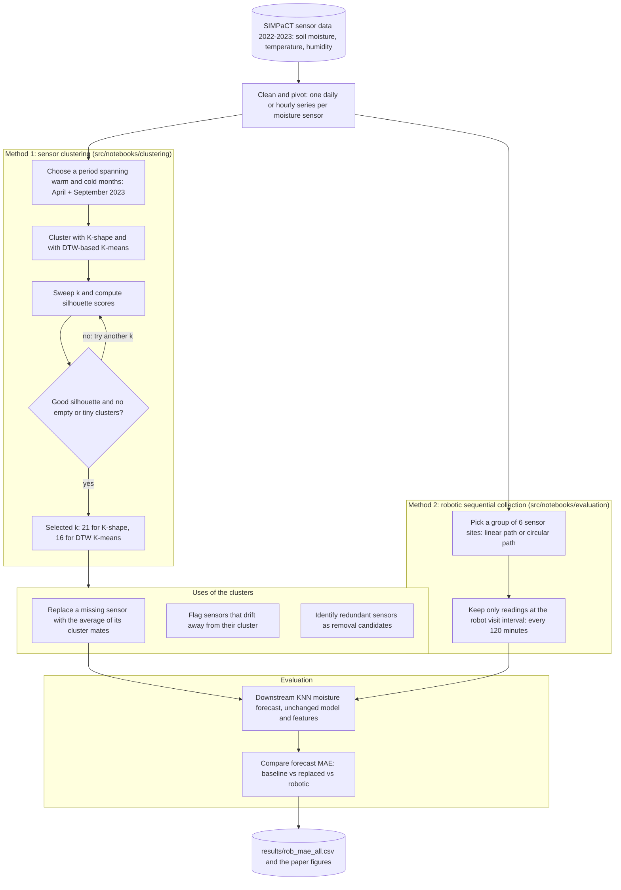

# SIMPaCT: Sensor Data Optimisation for Smart Irrigation

Code for reducing the sensor burden of a large smart-irrigation system, using **time-series clustering** to stand in for missing or redundant soil-moisture sensors and **robotic sequential sampling** to cut the number of fixed sensors.

**SIMPaCT (Smart Irrigation Management for Parks and Cool Towns)** is a research project, started in 2021, that irrigates Bicentennial Park in Sydney Olympic Park so as to get the most transpiration cooling from the least water. Its machine-learning and digital-twin models are only as good as the sensor data they receive, and a network of 200+ soil-moisture sensors will always have failures and maintenance costs. This repository holds the notebooks used to study two ways of easing that problem on real SIMPaCT data.

> Project site: [simpact-australia.com](https://www.simpact-australia.com/)

## Why it is different

| Idea | What it buys you |
|---|---|
| **Cluster sensors by the shape of their behaviour.** Each sensor's soil-moisture series is one data point; K-shape and DTW-based K-means group sensors whose readings move alike. | A cluster tells you which sensors can vouch for one another. |
| **Cluster over a warm and a cold period together.** The paper concatenates April and September 2023 before clustering. | Sensors are grouped only if they agree in both seasons, not just in one. |
| **Judge k by silhouette *and* occupancy.** The best average silhouette can hide empty or tiny clusters. | Avoids picking a k whose "best" score comes from degenerate clusters. |
| **Impute a missing sensor from its cluster mates.** The replacement series is the average of the other sensors in its cluster. | Keeps the downstream models fed when a sensor drops out. |
| **Reuse the same clusters for diagnostics.** A sensor that leaves its cluster mid-period is flagged; sensors that mirror others are removal candidates. | One analysis serves data repair, anomaly detection and network pruning. |
| **Emulate robots rather than fixed sensors.** A group of sensor sites is visited in turn by one robot, so only readings at the visit interval are used. | Estimates the accuracy cost of replacing many sensors with a few moving ones before buying any robot. |
| **Score everything with the production metric.** Every variant is judged by the forecast MAE of a downstream moisture model. | Measures what matters to irrigation decisions, not just clustering quality. |

See [docs/how-it-works.md](docs/how-it-works.md) for the details.

## Workflow



## Repository layout

```
src/notebooks/
  clustering/    K-shape and DTW K-means clustering; silhouette sweep over k
  evaluation/    sensor replacement and robotic path emulation, scored by forecast MAE
data/
  example_model_input.csv     small sample of the model input format
  sensor_locations/           interactive map of the sensor sites
results/
  rob_mae_all.csv             per-sensor, per-date MAE: Base, Linear and Circular paths
docs/
  how-it-works.md             method walkthrough mapped onto the notebooks
  usage.md                    environment, data layout and how to run the notebooks
CITATION.cff                  machine-readable citation
```

## Quick start

Setup, the expected data files and the order in which to run the notebooks are in [docs/usage.md](docs/usage.md). In short:

```bash
pip install pandas numpy matplotlib tslearn scikit-learn statsmodels jupyter
jupyter lab src/notebooks
```

The full SIMPaCT sensor dataset is not published here. `data/example_model_input.csv` shows the schema so you can run the code on your own sensor network.

## Paper

Ghadiri, N., Javadi, B., Obst, O., Pfautsch, S.: *Data Optimisation of Machine Learning Models for Smart Irrigation in Urban Parks.* 2024 International Conference on Ubiquitous Computing and Communications (IUCC), IEEE, 2024, pp. 70-77.
[Publisher page (DOI)](https://doi.org/10.1109/IUCC65928.2024.00012) | [arXiv preprint](https://arxiv.org/abs/2410.02335)

The paper contains the full description, experimental setup, tables and figures. The documents here are an independent, shorter guide to the code, not a reproduction of the paper.

If you use this work, please cite:

```bibtex
@inproceedings{ghadiri2024simpact,
  title     = {Data Optimisation of Machine Learning Models for Smart Irrigation in Urban Parks},
  author    = {Ghadiri, Nasser and Javadi, Bahman and Obst, Oliver and Pfautsch, Sebastian},
  booktitle = {2024 International Conference on Ubiquitous Computing and Communications (IUCC)},
  pages     = {70--77},
  year      = {2024},
  publisher = {IEEE},
  doi       = {10.1109/IUCC65928.2024.00012}
}
```

## License and copyright

- **Code** in this repository is released under the [GNU GPL v3](LICENSE).
- **The published paper** remains under the copyright of its publisher (IEEE, 2024). It is not included in this repository, and nothing here reproduces its text, figures or tables. Please use the links above to read it.
- **The documentation** in this repository is original explanatory text written for this project.
- **Data:** the SIMPaCT sensor data belongs to the SIMPaCT project; only a small sample file is included.
